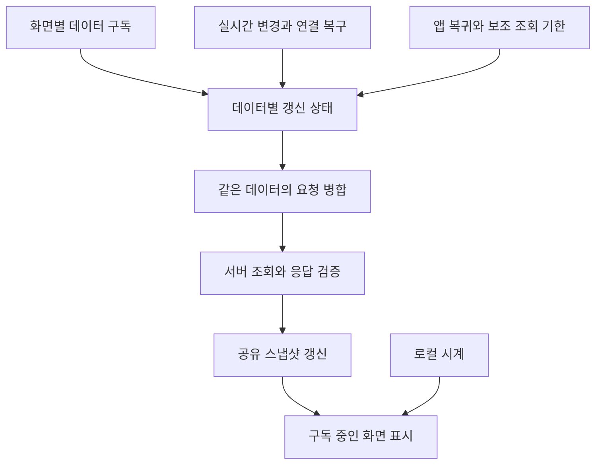

# 공부방 데이터 갱신 정책과 개선 설계

작성일: 2026-10-29  
상태: 2·3단계 구현 완료. 이를 위한 내 기록·친구 조회 분리를 포함하며, 4단계 공통 스케줄러와 5단계 Android 가드 개선은 미적용.

공부방의 친구 상태와 스킨은 빠르게 반영하면서, 보이지 않는 화면의 조회와 겹치는 요청을 줄인다. 화면이 필요한 데이터를 구독하고, 변경 이벤트를 기본 갱신 계기로 사용한다. 정기 조회는 실시간 연결에서 놓친 변경을 복구하는 역할로 남긴다.

화면별 수요와 앱 활성 상태를 적용하고, 자원별 보조 조회를 연결 상태와 실패 횟수에 따라 조정했다. 공부 기록의 저장·복구 규칙, 표시용 1초 시계, Android 공부 가드의 1초 확인은 유지한다. 의존성·서버 스키마·권한 변경은 없다.

## 변경 전 동작

아래는 변경 전 코드 기준이다. 현재 정책은 다음 절부터 설명한다. 공부방 기능이 사용하는 반복 타이머는 기본 4개이며, Android 공부 가드 모듈이 활성화된 환경에서는 5개다. 김 애니메이션, 요청 제한시간, 인증 라이브러리 내부 타이머는 이 집계에서 제외한다.

| 대상 | 간격 | 동작 | 코드 |
|---|---:|---|---|
| 친구 현황 | 10초 | `get_room`으로 친구의 공부 상태·캐릭터·적용 스킨 등을 조회 | `src/features/study/StudyProvider.tsx`의 `roomInterval` |
| 내 기록과 친구 현황 | 60초 | `refresh()`에서 친구 조회를 시작하고 `get_today` 및 기기 기록 정합성 확인을 수행 | 같은 파일의 `interval`, `refresh` |
| 포스트잇 | 15초 | `get_room_postits`로 누락된 변경을 복구 | `src/features/postits/usePostits.ts` |
| 표시용 공통 시계 | 1초 | 로컬 시각을 갱신하고 공부 날짜가 바뀌면 재조회 | `StudyProvider.tsx`의 `tick` |
| Android 공부 가드 | 1초 | 기기의 감시 상태를 읽고 상태가 바뀌면 재조회 | 같은 파일의 `guard.status()` 확인 |

친구의 10초·60초 정기 조회는 `useRefreshOnResume`을 통해 앱 활성 여부를 확인한다. 집중 화면의 포커스까지 확인하는 구조는 아니어서, 다른 탭을 보고 있어도 공통 `StudyProvider`가 마운트돼 있으면 실행될 수 있다. 포스트잇 조회는 앱 활성 상태와 해당 화면의 포커스를 모두 확인한다.

표시용 시계의 반복 콜백에는 별도의 앱 활성 검사문이 없다. 화면의 시간 구독은 `useScreenNow`에서 포커스를 확인한다. 타이머 등록 여부, OS의 백그라운드 실행 제한, 실제 서버 조회 여부는 구분해야 한다.

고정 간격 외에 다음 갱신 경로가 있다.

- 같은 방의 `profiles`, `study_sessions` 실시간 변경 알림은 친구 현황을 다시 조회한다. 재연결 때도 조회한다.
- 포스트잇은 실시간 Broadcast 메시지를 받으면 로컬 목록에 반영한다. 구독 연결 완료나 해석할 수 없는 이벤트 수신 시에는 목록을 다시 조회한다.
- 앱 복귀, 웹 탭 재노출·온라인 복구, 공부 시작·중지, 초기 복구와 공부 날짜 전환도 갱신 계기가 된다.
- `createSharedRequest`는 진행 중인 요청을 공유하고, 요청 중 변경 알림이 도착하면 후속 조회를 예약한다. 이 보호 장치를 유지한다.

현재 60초 `refresh()`도 `refreshRoom()`을 호출하므로 친구 조회의 계기가 겹친다. 다만 실제 서버 호출 횟수는 요청 병합·실시간 이벤트·화면 상태에 따라 달라지므로 타이머 수만으로 계산하지 않는다.

## 구현 구조

화면은 필요한 데이터를 선언하고, 데이터별 갱신 상태를 관리하는 공통 계층이 조회 시점을 결정한다. 렌더링과 서버 저장은 이 계층의 책임에서 분리한다.

새 계층은 기존 `StudyProvider`, `usePostits`, `createSharedRequest`를 이용하는 작은 공통 훅과 정책 함수로 구성했다. 자원별로 조회 완료 후 다음 `setTimeout` 하나를 예약한다. 모든 자원의 기한을 합치는 공통 스케줄러는 도입하지 않았다.

## 화면별 조회 수요

앱이 활성 상태이면서 실제로 필요한 화면이 보일 때 보조 조회를 실행한다. 같은 데이터의 화면 구독 수를 세어 마지막 구독이 해제되면 관찰용 조회를 중지한다. 화면별로 다른 간격을 지정하는 기능은 없다.

| 화면 | 필요한 데이터 | 화면을 벗어났을 때 |
|---|---|---|
| 홈 | 내 오늘 기록, 공부 중인 친구 요약 | 다른 화면의 구독이 없으면 관찰용 보조 조회 중지 |
| 집중 | 내 오늘 기록, 친구 현황과 스킨, 포스트잇 | 집중 전용 포스트잇 조회와 구독 정리 |
| 친구 화면 | 친구 현황 | 내 오늘 기록은 정기 조회하지 않음 |
| 기록·프로필·목표·휴가 화면 | 내 오늘 기록 | 친구 현황은 정기 조회하지 않음 |

화면 구독 해제는 공부 중지나 진행 중 저장 요청 취소를 의미하지 않는다. 초기 세션 복구, 공부 시작·중지와 확정되지 않은 요청 복구는 화면 수요와 별개로 완료해야 한다.

홈·집중 등은 `useStudyResources(['today', 'room'])`, 친구 화면은 `['room']`, 기록·프로필·목표·휴가 화면은 `['today']`를 선언한다. 포커스 진입·해제는 `useFocusEffect`로 구독 수에 반영한다. 포스트잇은 `usePostits`가 집중 화면 포커스와 앱 활성 상태를 직접 확인한다.

## 적용한 데이터별 정책

아래 간격을 적용했다. 요청 시작 시각이 아닌 완료 시각부터 다음 간격을 센다. 실제 기기의 이벤트 전달 지연·누락 복구 시간·요청량 측정에 따른 조정은 후속 작업이다.

| 데이터 | 기본 갱신 계기 | 연결이 정상일 때 보조 조회 | 실시간 연결이 끊겼을 때 |
|---|---|---:|---|
| 친구 현황과 스킨 | 관련 프로필·공부 세션 변경, 화면 진입·복귀·재연결 | 필요한 화면에서 60초 | 화면이 보이고 요청이 가능한 동안 15초 간격으로 복구 조회 |
| 내 오늘 기록 | 시작·중지 결과, 내 데이터 변경, 화면 진입·복귀, 공부 날짜 전환 | 필요한 화면에서 60초 | 실시간 연결과 무관하게 조회 가능 여부에 따라 재시도 |
| 포스트잇 | 기존 Broadcast 반영, 화면 진입·복귀·재연결 | 집중 화면에서 60초 | 집중 화면에서 15초 간격으로 복구 조회 |
| 표시용 공부 시간 | 공통 로컬 시계와 서버 시각 기준점 | 1초마다 화면 숫자 계산 | 마지막 서버 기준점으로 계산하며 서버 조회 실패와 구분 |

연결이 정상이라는 판단은 관련 변경 구독의 상태를 기준으로 한다. 소켓 접속만으로 모든 데이터가 최신이라고 판단하지 않는다. 이벤트가 조용하다는 이유만으로 조회 간격을 무한히 늘리지 않는다.

네트워크 요청 실패가 반복되면 해당 데이터의 재시도 간격을 5초·10초·20초·40초·최대 60초로 늘린다. 각 간격에 ±10% 임의 지연을 적용하되 60초를 넘지 않는다. 반복 변경 알림은 예약된 실패 재시도를 앞당기지 않으며, 연결이 정상으로 복구되면 즉시 재동기화한다. 정상적인 실시간 연결 해제 상태의 15초 보조 조회와 요청 실패 후 재시도는 하나의 다음 실행 기한으로 합쳐, 두 요청 루프가 동시에 돌지 않게 한다. 성공하면 실패 횟수를 초기화한다.

내 기록의 조회 함수는 친구 현황 조회를 포함하지 않도록 분리한다. 최초 진입이나 복귀에서 둘 다 필요하면 조정 계층이 각각 요청하고, 친구 응답을 기다리느라 내 타이머 표시를 늦추지 않는다.

## 이벤트와 요청 병합 규칙

- 친구 스킨·공부 상태의 변경 알림은 서버 조회를 유도한다. 부분 이벤트만으로 전체 친구 스냅샷을 임의로 재구성하지 않는다.
- 내 데이터의 변경 알림은 내 기록도 갱신한다. `get_today`의 내 프로필도 Identity에 반영하므로 친구 목록을 조회하지 않는 화면에서도 내 스킨 변경을 동기화한다. 변경 주체가 내 사용자면 내 기록도 갱신하고, 다른 사용자면 친구 현황만 갱신한다. 주체를 판별할 수 없으면 구독 중인 양쪽을 갱신한다.
- 포스트잇은 기존 Broadcast 병합과 조회 중 도착한 이벤트 재적용 규칙을 유지한다.
- 동일 사용자·방·데이터에 대한 동시 조회는 진행 중인 Promise를 공유한다. 보조 조회 기한이 겹쳤다는 이유로 추가 후속 조회를 만들지 않는다.
- 실제 변경 이벤트가 요청 도중 도착하면 변경 여부를 기록하고, 완료 후 후속 조회를 한 번 예약한다. 이후 이벤트가 계속 들어오면 새 변경에 대한 후속 처리를 유지한다.
- 서로 다른 데이터인 내 기록과 친구 현황은 독립적으로 실행한다. 한쪽 오류가 다른 쪽 결과를 막지 않는다.
- 사용자·방 전환 시 세대를 바꾼다. 이전 사용자나 방의 늦은 응답은 현재 스냅샷에 반영하지 않는다.
- 구독이 끊긴 동안 마지막 스냅샷을 보존하고, 화면 재진입 시 갱신한다. 별도 오래됨 배지는 추가하지 않았다. 서버 값 자체를 임의로 수정하지 않는다.

## 생명주기와 로컬 작업

백그라운드와 숨겨진 웹 탭에서는 관찰용 보조 조회·재시도를 중지한다. 다시 활성화되면 구독 중인 데이터를 한 번 갱신하고 다음 실행 기한을 다시 계산한다. 화면 복귀와 실시간 재연결이 겹쳐도 같은 데이터의 조회는 병합한다.

표시용 시계는 하나의 서버 시각 기준점을 공유하고 필요한 화면만 구독한다. 매초 서버 데이터를 다시 받거나 공부 시간을 서버에 쓰지 않는다. 백그라운드에서 매초 값을 누적하지 않아도 복귀 시 기준 시각으로 경과 시간을 계산할 수 있어야 한다.

공부 날짜의 한국시간 오전 6시 전환은 별도 경계 이벤트로 처리한다. 앱이 활성 상태라면 경계에 맞춰 관련 데이터를 갱신하고, 경계를 지나 백그라운드에서 돌아왔으면 복귀 갱신에서 처리한다.

Android 공부 가드의 1초 확인은 이번 첫 개선 범위에서 유지한다. 네이티브 상태 이벤트 지원 여부와 누락 시 복구 경로를 검증한 뒤 별도로 개선한다. 서버 폴링 최적화 때문에 공부 이탈 감지나 종료 시각이 달라져서는 안 된다.

## 단계별 적용 상태

1. **내 기록과 친구 조회 분리 — 선행 작업 완료**  
   `refresh()` 안의 친구 조회 결합을 해소하고 초기 복구·시작·중지·복귀 등 호출 지점에서 필요한 자원을 명시한다. 기존 중복 요청 공유와 세대 검사를 유지한다.
2. **화면별 수요와 앱 활성 상태 적용 — 완료**  
   홈·집중·친구 화면에서 사용하는 자원을 선언한다. 구독자가 없어도 끝내야 하는 저장·복구 작업은 관찰용 조회와 분리한다.
3. **실시간 상태에 따른 보조 조회 조정 — 완료**  
   정상 연결에서는 60초 보조 조회, 연결 해제에서는 제한된 복구 조회, 실패 시에는 간격을 늘리는 정책을 적용한다. 복귀·재연결·변경 이벤트를 같은 요청 병합 경로로 보낸다.
4. **공통 실행 기한 관리 — 미적용**  
   자원별 다음 조회 기한을 관리하고 가장 가까운 기한에 실행한다. 타이머 개수 감소보다 실제 요청 중복과 불필요한 활성 시간을 줄이는 데 초점을 둔다.
5. **Android 가드 별도 검토 — 미적용**  
   네이티브 상태 이벤트의 신뢰성과 실제 기기 동작을 확인한 뒤 기존 1초 감시의 대체 여부를 결정한다.

## 검증 기준

| 상황 | 확인할 동작 |
|---|---|
| 집중 화면을 계속 표시 | 숫자는 매초 바뀌고 친구 스킨·공부 변경은 실시간 알림 후 반영됨 |
| 조회 중 친구 변경 이벤트 수신 | 진행 중 조회와 필요한 후속 조회로 변경을 반영하며 요청이 무한히 겹치지 않음 |
| 보조 조회와 화면 복귀가 동시 발생 | 같은 데이터 조회를 공유함 |
| 다른 탭으로 이동 | 해당 탭에서 필요하지 않은 공부방 관찰용 조회가 중지됨 |
| 집중 화면을 벗어남 | 포스트잇 보조 조회와 구독을 정리하고 늦은 응답이 화면 상태를 되돌리지 않음 |
| 실시간 연결만 끊김 | 보이는 화면에서 복구 조회가 동작하고 재연결 때 한 번 재동기화됨 |
| 네트워크 요청 실패 반복 | 요청 간격이 늘어나며 마지막 정상 데이터와 오류 상태를 구분함 |
| 백그라운드 후 복귀 | 숨겨진 동안 누적된 조회를 한꺼번에 실행하지 않고 최신 스냅샷을 조회함 |
| 계정·방 변경 중 이전 응답 도착 | 이전 응답을 버리고 데이터·구독·재시도 상태를 새 범위로 분리함 |
| 오전 6시를 지나 복귀 | 오늘 기록과 포스트잇의 공부 날짜가 함께 새 날짜로 전환됨 |
| 공부 시작·중지 응답 유실 | 기존 요청 ID·잠금·영구 저장·복구 규칙을 보존함 |
| Android 이탈 감지 | 기존 가드의 감지·종료 시각과 기록 정합성을 보존함 |

자동 테스트는 가짜 시계와 요청 제어로 기한, 동시 이벤트, 재시도, 구독 해제와 응답 순서 역전을 검증한다. `resource-refresh`, `study-provider-refresh`, `postit-refresh` 테스트는 숨김·복귀, 무구독 초기 복구, 공부 시작·중지 중 응답, 계정 변경, Broadcast 삭제 보존, 오전 6시 전환을 다룬다. 검증 결과: 전체 테스트 252개, lint, typecheck, Storybook 정적 빌드 통과. Storybook 빌드에는 번들 크기 경고가 남아 있다. 실제 Android 기기와 실제 네트워크 단절·복구의 수동 검증은 아직 수행하지 않았다.

전후 비교는 같은 사용자 수·이벤트 수·화면 체류 시간에서 수행한다. `get_room`, `get_today`, 포스트잇 조회의 호출 수·중복 요청·실패와 이벤트 수신부터 화면 반영까지의 지연을 측정한다. 요청 횟수 감소율이나 배터리 개선 효과는 측정 전 확정하지 않는다.

## 범위

이 설계는 조회·동기화의 실행 정책을 개선한다. 서버 권한·공부 기록 계산·스킨 지급·기본 타이머 모드·APK 버전 정책은 변경하지 않는다. SQL이나 Realtime publication 변경이 필요해지면 구현 단계에서 기존 권한과 배포 범위를 별도로 검토한다.

## 구현 파일

| 파일 | 역할 |
|---|---|
| `src/lib/resource-refresh.ts` | 자원별 완료 기반 타임아웃, 요청 병합, 실패 재시도 |
| `src/hooks/useResourceRefresh.ts` | 자원 범위·앱 활성 상태·복귀 이벤트 연결 |
| `src/hooks/useAppActive.ts` | 네이티브 AppState·웹 visibility 외부 저장소 구독 |
| `src/lib/study-resource-demand.ts`, `src/features/study/study-resources.tsx` | 화면별 수요 집계·포커스 해제 |
| `src/features/study/StudyProvider.tsx` | 내 기록·친구 조회 분리와 초기 복구·저장 경로 유지 |
| `src/features/postits/usePostits.ts` | 포커스·Broadcast 상태에 따른 조회 정책 |
| `src/data/study.ts` | 변경 알림의 사용자 식별 |

## 관련 문서와 코드

- [기존 친구 실시간 갱신 구현](execution/reports/friend-realtime-refresh.md)
- [초기 진입 및 타이머 시작 성능 개선](execution/reports/startup-timer-performance.md)
- `src/features/study/StudyProvider.tsx`, `src/features/study/useScreenNow.ts`
- `src/features/study/study-clock.ts`, `src/lib/study-clock.ts`
- `src/hooks/useRefreshOnResume.ts`, `src/lib/shared-request.ts`
- `src/data/study.ts`, `src/features/postits/usePostits.ts`
- [Supabase 변경 구독 공식 문서](https://supabase.com/docs/guides/realtime/postgres-changes)
- [React Native 앱 활성 상태 공식 문서](https://reactnative.dev/docs/appstate)
- [React 외부 저장소 구독 공식 문서](https://react.dev/reference/react/useSyncExternalStore)
