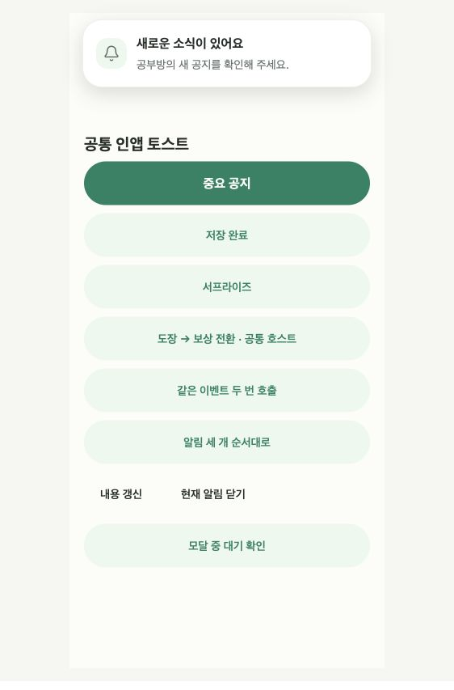

# 공통 인앱 토스트

웹앱과 iOS·Android 앱은 `src/design/toast`의 동일 API를 사용한다. 루트 `AppToastProvider`가 로그인 사용자·공부방 범위를 연결하고, 각 화면은 `useToast()`로 호출한다. 새로운 라이브러리나 플랫폼 전용 토스트 모듈은 추가하지 않았다.

```tsx
import { useToast } from '../design/toast'; // 호출 파일에 맞는 상대 경로

function SaveButton() {
  const toast = useToast();
  async function save() {
    await saveChanges();
    toast.show({
      title: '변경사항을 저장했어요',
      tone: 'success',
      durationMs: 2000,
      dedupeKey: `saved:${operationId}`,
    });
  }
  // 기존 버튼에서 save를 호출한다.
}
```

## API

- `toast.show(options)` → 토스트 ID 또는 `null`. `title` 또는 `message` 중 하나 이상과 `tone: 'info' | 'success' | 'reward'`를 지정한다. 기본 유지 시간은 4초이며 `durationMs`로 바꿀 수 있다.
- `toast.update(id, patch)` → 갱신 성공 여부. 이미 닫힌 ID는 `false`이고 재표시하지 않는다. 제목·본문만 갱신하면 처음 표시 시각과 남은 시간을 유지한다. `durationMs`를 명시적으로 갱신한 경우에만 새 시간으로 다시 시작한다.
- `toast.dismiss(id)` → 현재 또는 대기 중인 해당 알림을 제거한다.
- `toast.clear()` → 현재 범위의 활성·대기 알림을 모두 제거한다.
- `onShow()`는 대기열 등록 시점이 아닌 실제 호스트 마운트 때 한 번 호출한다.
- `onDismiss(reason)`은 timeout/manual/blocked/background/scope/unmount 등 종료 이유를 받는다. 등록이 거절된 `ToastSlot`은 rejected를 받는다.

`id`는 화면에서 관리할 고유 ID이고 생략하면 자동 생성한다. `dedupeKey`는 서버 요청·이벤트의 고유 ID를 사용한다. 같은 사용자 범위에서 동일 키를 호출하면 활성/대기 알림은 하나로 합쳐지고, 이미 표시 완료된 이벤트는 중복 표시하지 않는다. 반복 안내가 필요한 서로 다른 사건에는 서로 다른 키를 쓴다. 종료 키는 메모리에 최근 100개까지만 유지하며 공통 토스트는 본문·알림 이력을 저장하지 않는다.

## 표시와 종료 정책

아이콘은 기본 표시하며 `showIcon: false`로 숨긴다. `title`을 생략하면 본문만 표시한다. 생략한 아이콘·제목 자리는 여백으로 남기지 않는다. 제목과 본문이 모두 비어 있으면 등록하지 않는다.

```tsx
toast.show({ title: '새로운 소식이 있어요', message: '공부방의 새 공지를 확인해 주세요.', showIcon: false });
toast.show({ message: '변경사항을 저장했어요.', showIcon: false });
```

- 안전 영역 안 상단에 하나씩 표시한다. 활성 알림 1개와 최대 대기 5개를 유지하며 이후 등록은 `null`이다.
- 유지 시간은 실제로 마운트됐을 때 시작한다. 다른 알림 뒤에서 기다리는 동안 시간이 소모되지 않는다.
- 기본 안내는 유지 시간이 끝나면 200ms 동안 위로 살짝 이동하며 페이드아웃한 뒤 대기열의 다음 알림으로 넘어간다. 기본 4초 안내는 퇴장까지 약 4.2초이다. 퇴장 중 늦은 내용 갱신은 무시하며, 동작 줄이기 설정에서는 퇴장 대기 없이 제거한다. 자체 퇴장을 갖는 성취 콘텐츠에는 효과를 중복 적용하지 않는다.
- 모달·키보드가 열린 상태에서 새로 등록된 알림은 대기한다. 표시 중인 알림이 가려지면 종료하고 복원하지 않는다.
- 초기 입장 전과 백그라운드에서 새 등록은 거절한다. 앱 이탈·로그아웃·공부방 변경은 현재 알림과 대기열을 비운다.
- 이전 사용자·공부방에서 얻은 API 콜백은 범위가 바뀌면 무효다. A→B→A로 돌아온 경우에도 이전 A 방문의 콜백은 거절한다.
- 기기별 키보드·AppState 처리와 웹의 문서 표시·입력 포커스 처리는 공통 환경 훅이 구분한다.
- 기본 안내는 닫기 버튼 없이 자동으로 사라진다. 동작 줄이기에서는 등장 이동을 생략하고, 네이티브에서 스크린리더 활성 상태가 확인되면 최소 10초를 제공한다. 웹은 스크린리더 사용을 감지할 수 없어 RN Web의 항상 true인 호환 응답을 사용하지 않으며, 기본 4초와 ARIA 안내를 유지한다.

## 전용 콘텐츠

임의 콘텐츠는 `show({ render, durationMs })`로 전달할 수 있다. `render`에는 `dismiss`, `reducedMotion`, `screenReader`가 전달된다.

```tsx
const id = toast.show({
  title: '새로운 선물이 있어요',
  tone: 'reward',
  durationMs: 3000,
});
if (id) toast.update(id, { message: '선물함에서 확인할 수 있어요.' });
```

도장→보상처럼 단계별 유지 시간이 필요한 콘텐츠는 `ToastSlot`을 사용한다.

```tsx
<ToastSlot id={`achievement:${room}:${uid}:${date}`}
  dedupeKey={`achievement:${room}:${uid}:${date}`}
  onShow={markStarted} onDismiss={clearNotice}>
  <CelebrationToast notice={notice} onDismiss={clearNotice} />
</ToastSlot>
```

`ToastSlot`은 `show`/`update`/`dismiss`를 연결하는 어댑터이며 위치·대기열·중복 처리는 같은 호스트가 담당한다. `durationMs: null`로 공통 자동 타이머를 끄고 콘텐츠가 자신의 전환 완료 후 종료를 요청한다. 이 경우 반드시 자체 종료 또는 `dismiss` 경로를 제공한다. 성취 토스트는 기존처럼 도장 후 기본 4초, 보상 후보일 추가 대기 최대 2초, 보상 전환 완료 후 2초를 사용한다. 스크린리더 예외는 10초를 유지한다.

기기 재실행 후에도 필요한 읽음/시작 정책은 각 기능이 소유한다. 성취 알림의 경우 기존 AsyncStorage 날짜 키를 `onShow`에서 덮어쓰며, 대기만 하다가 취소된 알림은 봤다고 기록하지 않는다.

## 확인

Storybook의 `공통 컴포넌트/공통 토스트`에서 일반 안내·완료·서프라이즈·성취 콘텐츠·중복·순서·내용 갱신·모달 대기를 실행할 수 있다. `아이콘 없음`, `본문만`, `320px 본문만` 스토리에서 버튼으로 반복 확인할 수 있다.

```bash
npm run storybook -- --port 6007
node --experimental-strip-types --test tests/toast-store.test.mjs tests/toast-provider.test.mjs tests/celebration-controller.test.mjs
```

웹은 실제 Storybook으로 확인한다. iOS·Android 호환 코드를 공유하되 실기기 시각 검증은 별도이며 이 문서는 실기기 검증 완료를 의미하지 않는다.


