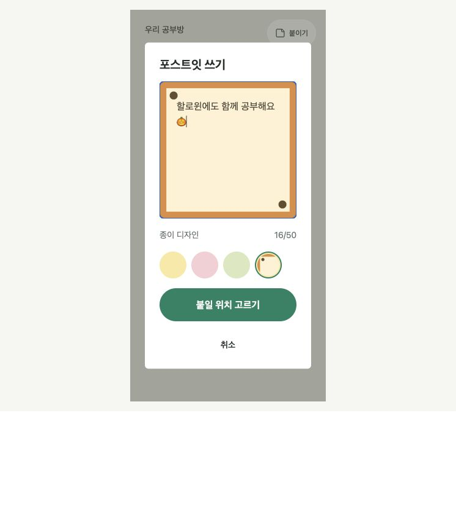
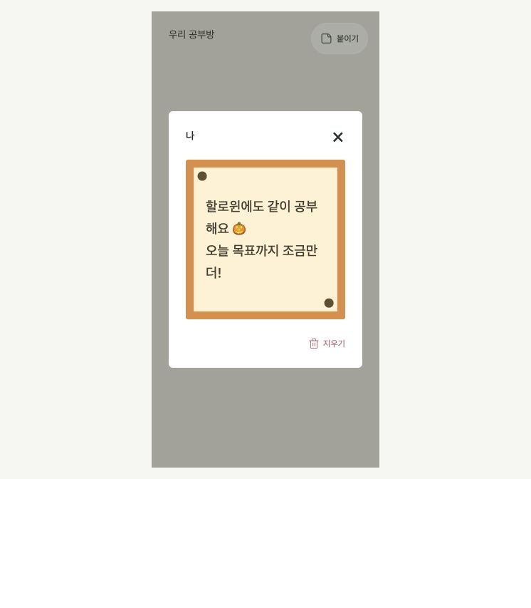

# 포스트잇 디자인 운영

상태: 로컬 구현·검증 / 공유 서버 및 앱 배포 전. [기능 명세](../proposals/POSTIT-DESIGNS-SPEC.md)를 함께 본다.

## 준비와 배포

- 의존성: [PR #49](https://github.com/Daeun-100/-YumYumStudy/pull/49)의 이벤트 운영·원격 이미지 서버와 앱 코드. 기존 Storage `event-artwork`, 주제별 이미지 라이브러리와 PNG 검사·다운로드 제한을 재사용한다.
- 이 브랜치는 최신 develop에서 시작해 #49를 병합한 작업본이다. #49가 먼저 develop에 병합되면 이 PR의 변경 범위가 포스트잇 기능으로 줄어든다. #49의 이후 스키마 변경과 충돌 여부도 병합 전 확인한다.
- `20261029162732_postit_design_rewards` 마이그레이션과 지원 앱을 기존 릴리스 절차로 반영한 뒤 실제 디자인과 보상 규칙을 활성화한다. 이 문서가 production 배포·업로드·행사 등록을 승인하거나 완료했음을 뜻하지 않는다.
- 최초 지원 코드 배포 후에는 같은 규격의 새 PNG와 보상 규칙 등록에 앱 재배포가 필요 없다.

## 디자인 PNG

종이 PNG는 가로·세로 각각 512–2048 px, 가로:세로 비율 1:2–2:1을 지원한다. 별도 원형 선택 이미지 preview는 선택 사항이며 정사각 PNG로 등록한다. 각 파일은 8비트 RGB/RGBA·비인터레이스, 2 MiB 이하다. 별도 preview가 없으면 종이 일부를 원형으로 잘라 표시한다. 글씨는 앱이 덧그리므로 중앙을 비우고 본문과 색상 대비를 확보한다.

현재 할로윈 배경은 assets/postits/halloween-paper-landscape.png (1437×1095), 선택 이미지는 사용자가 제공한 assets/postits/halloween-preview.png (1254×1254)다. 원래 세로 종이는 보존했다. 작성·읽기 종이는 공통 PostitSheet로 최대 가로 420, 가로:세로 21:16 고정 비율을 사용하며 작은 화면에서는 세로도 함께 줄인다. 배경은 원본 비율을 유지해 채운다. 작성 취소는 우측 상단 ×로 제공한다. 집중 화면의 모달은 타이머까지 포함한 전체 화면을 덮는다.

운영 환경에서 `SUPABASE_URL`과 비공개 `SUPABASE_SERVICE_ROLE_KEY`를 사용한다. 키는 명령 인자나 JSON에 넣지 않는다. 모든 명령은 저장소 루트에서 실행한다.

입력 예시 `/private/tmp/postit-definition.json`:

```json
{
  "id": "halloween-paper",
  "theme": "halloween",
  "name": "할로윈 포스트잇",
  "fallbackColor": "#F9E8A0",
  "textColor": "#453F30"
}
```

`fallbackColor`는 구형 앱 호환을 위해 기본 3색 중 하나다. `textColor`는 6자리 HEX 색상이다. PNG가 실패하면 기본 종이와 어두운 본문으로 표시한다. 임의 URL이나 사용자 업로드는 받지 않는다.

```sh
# 검사·manifest 생성만 수행한다. 이미지 버전 UUID는 입력하지 않는다.
node --experimental-strip-types supabase/scripts/manage-postit-designs.mjs prepare --definition /private/tmp/postit-definition.json --paper /absolute/path/paper.png --preview /absolute/path/preview.png --out /private/tmp/postit-manifest.json

# 업로드·공개 다운로드 해시 확인·독립 라이브러리 등록. 사용자 지급은 하지 않는다.
node --experimental-strip-types supabase/scripts/manage-postit-designs.mjs upload --definition /private/tmp/postit-definition.json --paper /absolute/path/paper.png --preview /absolute/path/preview.png

# 업로드된 PNG를 확인한 뒤 지급 가능 상태로 등록한다.
node --experimental-strip-types supabase/scripts/manage-postit-designs.mjs register --definition /private/tmp/postit-manifest.json --activate
node --experimental-strip-types supabase/scripts/manage-postit-designs.mjs list --theme halloween

# 신규 지급만 중지. 기존 보유와 이미 붙인 종이는 유지한다.
node --experimental-strip-types supabase/scripts/manage-postit-designs.mjs disable --design halloween-paper
node --experimental-strip-types supabase/scripts/manage-postit-designs.mjs enable --design halloween-paper
```

기본 파일 경로는 `halloween/postits/halloween-paper/paper.png`다. 입력 JSON의 `paper.path`로 같은 주제의 다른 PNG 경로를 명시할 수도 있다. 경로와 SHA-256으로 이미지 캐시를 구분한다. 기존 파일을 다른 이미지로 덮어쓰지 않는다. 응답 유실·부분 실패에는 같은 파일·경로·정의로 재시도한다. 다른 해시이면 중단하고 새 파일 경로를 등록한다.

이미 붙인 종이를 보존하기 위한 스냅샷 ID는 서버가 자동 생성한다. 운영자는 UUID를 생성·선택하거나 별도 이미지 버전을 게시하지 않는다. 같은 정의 재등록은 스냅샷을 늘리지 않는다. 새 정의는 이후 작성에 적용하고 과거 종이·파일·지급 근거는 보존한다.

## 공부 조건 자동 지급

최초 지원은 명시한 방의 **한 공부 날짜 안에 있는 시간 구간**에 공부한 정수 초 합계다. 목표·연차 여부와 관계없이 실제 공부 시간을 인정한다. 진행 중 세션도 서버에서 계산하며 구간 밖 시간은 제외한다.

다음은 예시이고 실제 할로윈 행사 등록이 아니다. 대상 방·기간·디자인은 관리자 요청으로 확정한다. 시간은 한국시간 오전 6시가 공부 날짜의 시작이다.

```json
{
  "request_id": "새 UUID로 교체",
  "event_id": "2026-halloween",
  "name": "할로윈 30분 공부",
  "document_path": "docs/events/2026-halloween.md",
  "room_id": 0,
  "design_id": "halloween-paper",
  "starts_at": "2026-10-31T06:00:00+09:00",
  "ends_at": "2026-11-01T06:00:00+09:00",
  "required_seconds": 1800
}
```

```sh
node --experimental-strip-types supabase/scripts/manage-postit-designs.mjs reward --request /private/tmp/postit-reward.json
node --experimental-strip-types supabase/scripts/manage-postit-designs.mjs report --id RULE_UUID
node --experimental-strip-types supabase/scripts/manage-postit-designs.mjs cancel --id RULE_UUID
```

- 규칙은 요청 UUID별 불변이며 같은 입력 재시도는 같은 규칙을 반환한다. 변경은 취소 후 새 요청 ID로 등록한다. 취소는 미처리 지급을 중지하고 기존 보유는 회수하지 않는다.
- 사용자 대상은 해당 방 입장 완료 사용자다. 서버가 자기 공부 기록으로 판정하며 일반 사용자는 규칙·지급 기록·보유를 변경할 수 없다.
- 서버가 다음 확인까지 남은 시간을 돌려주고 앱은 조건 경계에서 한 번 확인한다. 현황 갱신·공부 종료·복귀·작성창 진입·공부방 재연결에서도 확인한다. 수령 버튼·매초 요청·별도 주기 Cron은 없다.
- 앱을 닫은 동안 충족하면 다음 접속에서 지급할 수 있다. 기간이 끝나도 구간 내 조건을 충족한 기록의 누락 지급은 복구한다. 취소·디자인 지급 중지는 복구도 중지한다.
- 사용자+디자인은 한 번만 보유하고 사용자+규칙은 한 번만 처리한다. `granted`와 `already_owned`를 구분하며 기존 최초 지급 시각·근거는 유지한다. 지급 조회가 이미지 다운로드를 기다리지 않는다.
- 획득 안내는 기존 인앱 토스트로 기기별 최초 실제 표시 때 완료 기록을 저장한다. 보유 디자인 확인은 항상 작성창에서 가능하다. 푸시는 추가하지 않는다.

## 검증

```sh
npm run lint
npm run typecheck
npm test
node supabase/scripts/check-postit-designs-db.mjs /ABSOLUTE/PATH/TO/@electric-sql/pglite/dist/index.js
node supabase/scripts/check-themed-artwork-db.mjs /ABSOLUTE/PATH/TO/@electric-sql/pglite/dist/index.js
npm run build-storybook
```

격리 DB는 Storage·Cron·실제 네트워크의 대체 구현이다. 역할·권한·RLS·중복 방지·30분 경계·분할 세션·종료 이벤트 복구·구형 색상·고정 리비전을 확인한다. 실제 동시 DB 연결·Storage 업로드·Android 기기·iPhone 웹앱 수신은 배포 후 별도 확인한다.

Storybook `화면/포스트잇 디자인 보상`에서 원형 견본 선택·작성·붙이기·열람·이미지 실패 대체를 확인한다. `stories/assets/postit-paper-preview.png`는 코드로 만든 도형 검증 파일이며 실제 지급용 디자인이 아니다.

## 이번 로컬 검증 기록

- 전체 앱 테스트 393개 통과. 린트·타입 검사와 Storybook 정적 빌드, 테스트용 공개 설정의 웹 export·CSP 처리 통과.
- 격리 PostgreSQL의 새 포스트잇 디자인 검사 및 기존 원격 이미지 회귀 검사 통과. 실제 운영 DB에 마이그레이션을 적용하지 않았다.
- 웹 Storybook의 320px에서 원형 디자인 선택·입력·배치·열람을 조작하고 이미지 실패의 기본 종이 대체를 확인했다. 원형 버튼은 모두 44×44이며 실제 `aria-checked`도 확인했다.
- Android와 iPhone 실기기, 실제 PNG 업로드·행사 등록·자동 지급은 미검증이다. 푸시는 이번 기능에 포함하지 않는다.




