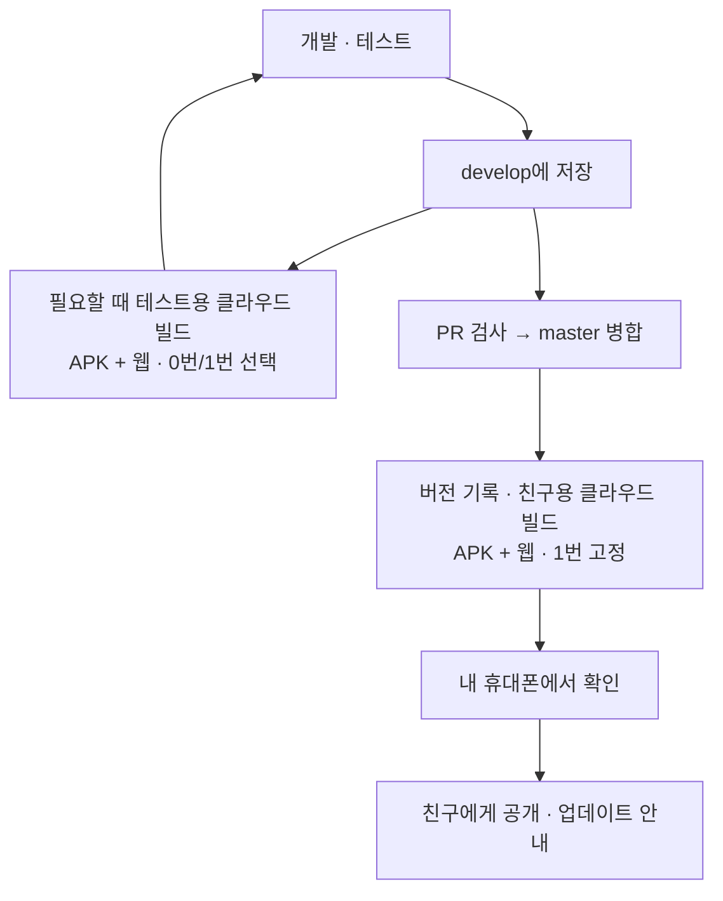
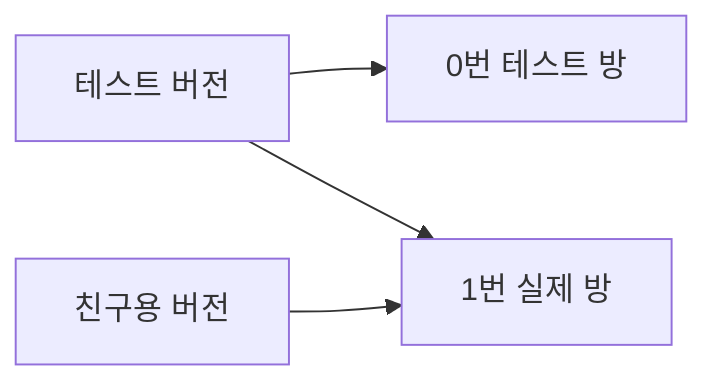

# 버전 및 배포 운영

정리일: 2026-10-28 (한국 시간)

## 현재 버전관리 규칙

이 절이 현재 기준이다. 아래 기존 운영 초안에서 모든 변경에 새 APK 버전을 요구하거나
EAS Update가 미구현이라고 적힌 부분보다 이 절과 [클라우드 빌드 안내](CLOUD-BUILDS.md)를 우선한다.

| 배포 | GitHub Release·태그 | 사용자 표시 |
|---|---|---|
| APK 배포 | `v1.0.2` | `v1.0.2` |
| 첫 업데이트 | `v1.0.2-r1` | `v1.0.2` |
| 두 번째 업데이트 | `v1.0.2-r2` | `v1.0.2` |
| 다음 APK 배포 | `v1.0.3` | `v1.0.3` |
| 해당 APK의 첫 업데이트 | `v1.0.3-r1` | `v1.0.3` |

- 기본 버전 `X.Y.Z`는 새 APK 배포 때만 올린다. 큰 호환성 변경은 Major, 기능 추가는 Minor,
  버그 수정·작은 개선은 Patch를 올리고 하위 자리는 0으로 초기화한다.
- `app.json`의 `expo.version`과 `package.json`의 version을 맞춘다.
  Android `versionCode`도 새 APK 때만 증가시킨다.
- 기존 APK와 호환되는 운영 업데이트는 기본 버전·versionCode를 유지한다.
  호환성 검토와 runtime 검증을 통과한 master 커밋만 기존 배포 흐름으로 게시한다.
- 업데이트 성공 후 `scripts/update-release.mjs`가 해당 APK의 기존 태그 중 가장 큰 `rN` 다음 번호로
  태그·Release를 만든다. 새 APK에서는 `r1`부터 시작하며 테스트·실패·skip에는 생성하지 않는다.
- `rN`은 수정 차수이며 배포 수단 이름을 포함하지 않는다. SemVer 크기 비교에는 사용하지 않는다.
- 업데이트 Release는 정식 배포 기록이며 prerelease로 표시하지 않는다. GitHub Latest는 APK로 유지하고,
  새 APK 다운로드 공지·웹 후보 승격 워크플로는 실행하지 않는다.
- Release 본문에는 대상 APK, 커밋, runtime, 변경 내용, 업데이트 그룹·ID와 배포 링크를 남긴다.
  `deployment-plan.json`, `eas-update.json`, `update-record.json`을 첨부하며 기존 배포 이력도 유지한다.
- 배포 작업은 production 동시 실행 잠금으로 직렬화한다. 기존 태그는 이동하거나 재사용하지 않는다.
  같은 업데이트 결과로 릴리스 기록 단계를 재시도하면 같은 태그·초안을 사용한다.
  전체 update 작업을 재실행해 새 업데이트 그룹이 게시되면 새 수정 차수를 부여한다.
- 앱 기본 버전은 업데이트로 바꾸지 않으며 사용자에게 `rN`을 표시하지 않는다.

## 전체 지문이 같은 의존성 선언 변경

의존성 선언 또는 package-lock 변경만으로 새 APK를 요구하지 않는다. 빌드에 설치된 의존성과
네이티브 그래프를 포함한 전체 원본 Android fingerprint가 공개 APK runtime과 정확히 같으면
EAS Update 호환으로 인정한다. 이 경로에서는 의존성·lockfile을 정규화하거나 제외하지 않는다.
지문 계산 실패·불일치는 OTA 승인이 아니며, 네이티브 소스·빌드 훅·지문 설정/제외 규칙·
검증되지 않은 빌드 스크립트 변경 차단은 유지한다. 기존의 검증된 배포 관리용 정규화는
의존성 입력이 바뀌지 않은 경우에만 별도로 적용한다. 앱 버전·versionCode 일치, 소스 검토,
기준 APK 검증 및 실제 게시 시 runtime/commit 검증도 계속 필요하다.

## 릴리스 변경 요약

배포 PR 준비 시 `.github/deployment-review.json`의 `releaseNotes`에 사용자 관점의 한국어 변경 요약을 문자열 배열로 작성한다. 각 항목은 무엇이 달라졌는지와 사용자가 할 수 있는 일을 짧게 설명한다. PR 제목·병합 커밋 메시지만 나열하거나 코드에서 확인하지 않은 효과를 쓰지 않는다. 직전 실제 운영 배포 이후의 변경을 요약하고, 운영 도구 변경은 사용자가 직접 쓰는 기능과 구분해 설명한다.

APK 공개 시 앱의 업데이트 모달에는 해당 APK 태그의 검증된 `releaseNotes`만 일반 텍스트 목록으로 등록한다. Android·웹 모두 같은 요약을 사용하며, GitHub Release 본문의 Markdown 제목·배포 후보 안내·빌드 번호·커밋 정보는 모달에 포함하지 않는다. 태그 소스와 검토 digest가 다르거나 요약이 비어 있거나 차단 사유가 남아 있으면 공개를 중단한다. GitHub Release 본문을 수동 수정해도 모달 요약은 바뀌지 않는다.

예: `"프로필에서 지급받은 캐릭터 스킨을 선택하거나 기본 모습으로 돌아갈 수 있습니다."`

PR 및 운영 배포 검사는 요약이 누락되거나 비어 있으면 중단한다. OTA와 APK 릴리스 모두 이 검토된 요약을 본문 첫 `변경사항` 항목에 사용하며, 커밋·런타임·업데이트 ID 등은 아래 배포 정보에 둔다. 자동화 재실행은 이미 공개된 릴리스 본문이나 수동 편집한 APK 초안을 덮어쓰지 않는다.

## 기존 운영 초안과 배경

구현 설정과 실행 방법의 최신 상태는 [클라우드 빌드 안내](CLOUD-BUILDS.md)를 참고한다.
이 문서의 도식은 목표 운영 방식이며 외부 인증·첫 빌드 검증 상태는 안내 문서에 별도로 기록한다.

## 합의한 방향

나를 포함한 친구 4명이 사용하는 앱이다. **작업 저장과 친구에게 공개하는 시점을 구분하고,
배포 파일은 GitHub에 저장된 정확한 코드로 클라우드에서 만든다.**

- 작업 브랜치는 `develop`, 배포 기준 브랜치는 기존 이름인 `master`를 사용한다.
- 작업 코드는 `develop`에 수시로 커밋·push한다. 배포할 파일만 매번 골라 커밋하지 않는다.
- 배포할 때 `develop → master` PR을 만들고 자동 검사 후 병합한다.
- 병합된 커밋을 고정해 클라우드에서 APK와 웹 배포 파일을 생성한다.
- 앱 버전, 배포 번호, Git 태그, 커밋, 빌드 결과를 함께 기록한다.
- 테스트 웹·APK를 매번 별도로 만들지는 않는다. 테스트 버전에서는 0번·1번 방을 선택할 수 있게 할 예정이다. 기본 진입은 0번이다.
- 클라우드에서 만든 배포 후보를 내가 먼저 확인하고 친구들에게 전달한다.

이 문서는 **앞으로 적용할 운영 방식**이다. 아래 ‘현재 상태’에 적힌 내용 외에
브랜치 보호, 자동 빌드, 태그 생성 등이 이미 설정되었다는 뜻은 아니다.

## 전체 흐름 한눈에 보기

클라우드 빌드를 사용한다. 아래는 앞으로 적용할 구조이며, 자동화와 테스트 버전의 방 선택은 아직 구현 전이다.



develop에서는 필요할 때 테스트용 APK·웹을 클라우드에서 만든다. 매 push마다 만들지는 않는다.
친구용은 master 병합 후 별도로 만든다. 문제가 있으면 개발 단계로 돌아가 수정한다.
같은 버전의 태그·커밋·APK·웹 결과를 함께 기록한다.



테스트 버전은 기본 0번이며 1번도 선택할 수 있게 한다. 1번은 실제 기록이고 첫 입장에는 초대 코드가 필요하다.

**친구의 첫 사용:** 링크 열기·APK 설치 → 초대 코드 → 이름 설정 → 홈. 다음부터 자동 입장한다.

## 현재 상태와 남은 설정

| 항목 | 현재 상태 | 바꿀 내용 |
|---|---|---|
| Git 브랜치 | 로컬과 저장된 원격 정보에 `master`만 있음 | `develop` 생성, 작업 기준으로 사용 |
| PR 검사 | 이 문서 작성 시 자동화 설정 여부를 별도 검증하지 않음 | lint·타입·테스트 필수 검사 구성 |
| 배포 승인 | 수동 작업 단계 | `master` 직접 push 제한, PR 검사·검토 후 병합 |
| APK | Expo 프로젝트 연결과 APK 빌드 프로필 준비 | GitHub의 고정 커밋으로 EAS 클라우드 빌드 연결 |
| 웹 | 로컬 웹 export 성공 | GitHub 기반 클라우드 빌드와 HTTPS 호스팅 구성 |
| 버전/태그 | 초기 설정 `1.0.0`, 배포 번호 `1` | 자동 검증·태그 생성·결과 기록 연결 |
| 데이터 구분 | Supabase 하나, 개발 실행은 0번·배포 실행은 1번 고정 | 테스트 버전은 0번·1번 선택, 친구용은 1번 고정으로 변경 |
| 실제 초대 코드 | 2026-10-27 서버 등록 및 일치 검증 완료 | 실제 기기에서 신규 입장 확인 |

GitHub 저장소: https://github.com/Daeun-100/-YumYumStudy

Expo 프로젝트: https://expo.dev/accounts/daeun-100s-team/projects/yumyumstudy

## 브랜치와 배포 흐름

```text
개발·수정
   ↓
develop에 커밋·push (작업 저장)
   ↓
develop → master PR
   ↓
자동 검사 + 변경 내용 확인
   ↓
master 병합 (배포 후보 확정)
   ↓
병합 커밋 고정 → 클라우드 APK·웹 빌드
   ↓
빌드 결과와 버전 기록 → 내가 먼저 확인
   ↓
친구용 웹 주소 갱신 / APK 링크 전달
   ↓
Supabase 업데이트 안내 활성화
```

`develop`에 push해도 친구용 앱은 바뀌지 않는다. `master` 병합은 배포 후보를
확정하는 단계로 두고, 친구용 고정 웹 주소를 바꾸는 단계는 별도로 둔다.
웹은 기존 주소에 새 파일이 공개되는 순간 사용자에게 반영될 수 있기 때문이다.
업데이트 안내를 꺼두는 것만으로 웹 공개를 막을 수는 없다.

첫 배포 전 작업 중인 변경 사항을 검토해 `develop`으로 가져간다.
`master`에 자동으로 전부 반영하거나 기존 작업을 버리지 않는다.
버전 수정이 포함된 PR을 병합한 뒤에는 그 변경을 `develop`에도 반영해 다음 작업의
버전 기준이 뒤처지지 않게 한다.

## 버전·태그·빌드 결과의 관계

| 항목 | 예시 | 역할 |
|---|---|---|
| 표시 버전 | `1.0.1` | 앱 안에서 사용자가 보는 버전 |
| 배포 번호 | `2` | 현재 앱보다 새 배포인지 비교하는 증가 번호 |
| Git 태그 | `v1.0.1` | 그 버전을 만든 정확한 Git 커밋을 가리킴 |
| 커밋 | 전체 커밋 SHA | 빌드 입력 코드를 식별 |
| 빌드 결과 | APK 링크, 웹 배포 ID | 실제 설치·사용할 산출물 |

태그는 APK 파일이나 배포 실행 자체가 아니다. 태그가 붙었다고 친구에게 공개된 것도 아니다.

현재 코드에서는 `app.json`의 `expo.version`이 표시 버전이고,
`expo.android.versionCode`가 Android·웹 공통 배포 번호다.
`package.json`의 version도 표시 버전과 맞춘다.

예: 앱 `1.0.1` / 배포 번호 `2` / Git 태그 `v1.0.1` / 커밋 A / 커밋 A로 만든 APK·웹.
같은 배포 번호로 다른 코드를 공개하지 않고, 이미 만든 태그를 다른 커밋으로 옮기지 않는다.
빌드가 실패하면 실패 상태를 기록한다. 코드를 고치면 새 커밋·새 버전으로 진행한다.
단순 빌드 인프라 오류는 같은 고정 커밋과 설정으로 재시도할 수 있고, 재시도 결과도 남긴다.

## 실수를 줄이기 위한 자동화 요구사항

다음 항목은 구현할 때의 기준이다. 지금 자동화가 완료된 것은 아니다.

1. PR에서 `npm ci`, lint, 타입 검사, 자동 테스트, 웹 export를 수행한다.
2. 필수 검사가 실패하면 `master`에 병합할 수 없도록 보호한다.
3. 버전 값과 배포 번호를 PR에서 검증한다. 기존 공개 버전과 중복되면 차단한다.
4. 빌드 입력은 이벤트가 가리키는 **전체 커밋 SHA**로 고정한다.
   빌드 시점의 ‘최신 master’를 다시 선택하지 않는다.
5. 릴리스 작업은 한 번에 하나씩 처리해 배포 번호·태그 충돌을 막는다.
6. 클라우드 빌드에도 동일한 커밋을 전달한다. 로컬 미커밋 파일을 업로드해서
   공식 배포 파일을 만드는 방식은 사용하지 않는다.
7. 태그는 자동화가 해당 병합 커밋에 생성하고, 기존 태그가 다른 커밋이면 중단한다.
8. APK와 웹은 같은 릴리스 설정·버전을 사용하고 결과를 하나의 배포 기록에 연결한다.
9. 친구용 고정 웹 주소 공개와 Supabase 업데이트 알림 활성화는 확인 뒤 수행한다.

현재 구현은 GitHub Actions와 EAS Build/Hosting을 사용한다. 실제 활성화 조건과 공개 순서는
[CLOUD-BUILDS.md](CLOUD-BUILDS.md)의 친구용 후보와 공개 절을 따른다.
환경 변수와 사용한 빌드 프로필도 결과에 기록해야 같은 코드의 빌드를 추적할 수 있다.
비밀값 자체는 기록하지 않는다.

## 빌드를 만드는 위치와 코드 추적

클라우드 빌드는 기술적 필수 조건이 아니다. 앞서 로컬 빌드를 지양하고 싶다는
선호에 맞춰 기본 운영 방향으로 선택했다. 로컬 빌드로 변경하더라도
확정 커밋·버전·입력 설정·서명 키·결과 파일을 연결해 기록하는 원칙은 같다.

- 클라우드: 공통 빌드 환경과 자동 검사·결과 링크를 묶기 편하다.
- 로컬: 내 컴퓨터에서 APK·웹 배포 파일을 만들 수 있다. Android 빌드 도구와 서명 설정이 필요하다.
- 어느 쪽이든 작업 중인 코드가 섞이지 않게 확정한 커밋의 깨끗한 별도 체크아웃에서 만든다.
- 클라우드도 로컬 폴더를 직접 업로드하면 미커밋 코드가 섞일 수 있다.
  클라우드라는 이유만으로 버전 추적이 보장되는 것은 아니다.

최종 선택은 클라우드 빌드이며, 로컬 빌드는 가능한 대안으로만 명시했다.

## 테스트 방과 실제 방

| 실행 형태 | 연결 방 | 용도 |
|---|---|---|
| 테스트 버전 (목표 구조) | 0번·1번 선택, 기본 0번 | 테스트 기록 확인과 실제 방 동작 확인 |
| 친구용 APK·배포 웹 | 1번 `얌얌스터디` | 실제 친구 4명의 기록 |

현재는 `src/lib/room.ts`에서 `__DEV__`로 구분한다.
따라서 **배포 모드로 만든 APK·웹은 테스트 목적으로 만들어도 1번 방에 연결된다.**
`develop` 브랜치라는 이유만으로 자동으로 0번 방을 쓰는 것은 아니다.

### 테스트 버전의 방 선택 (추가 합의, 아직 미구현)

- 테스트 버전은 0번·1번 방 모두 접근 가능해야 한다. 친구용은 1번 고정이다.
- 방을 바꾸면 그 방의 별도 인증 세션·UID·입장 단계를 사용한다.
  기존 UID의 room_id를 바꾸거나 두 방의 프로필을 합치지 않는다.
- 테스트 버전에서 실제 1번 방에 처음 입장할 때도 초대 코드와 이름 설정을 거친다.
  테스트 앱이라는 이유로 실제 방의 입장 검증을 우회하지 않는다.
- 현재 선택한 방을 눈에 띄게 표시한다. 1번에서 저장한 기록은 실제 기록이다.
- 방 전환 시 조회 데이터·실시간 구독을 다시 연결하고, 진행 중인 타이머나
  미확인 저장 요청이 있으면 먼저 처리한 뒤 전환한다.
- 기존 친구용 1번 방 인증 저장 키는 유지해 사용자 기록 연결을 보존한다.
- UI와 서버 응답을 포함한 실제 방 전환 구현 및 검증은 별도 작업으로 남아 있다.

테스트용 클라우드 APK·웹이 꼭 필요한 시점에는 빌드 환경으로 테스트 버전을 명시하고
0번·1번 방 선택 기능을 먼저 추가한다. 테스트 앱 ID와 웹 주소도 분리한다. 그 전에는 배포 후보가 1번 방을
사용한다는 점을 알고 실제 사용자 기록을 불필요하게 생성하지 않는다.

첫 배포, 로그인·입장·타이머·저장 기능 변경, 네이티브 의존성 변경은 휴대폰에서
집중 확인한다. 작은 문구 수정까지 매번 별도 테스트 APK를 만들 필요는 없다.

방별 인증 저장 키와 조회 권한은 분리되어 있지만 Supabase DB는 하나다.
DB 구조·서버 함수 변경은 0번·1번에 함께 영향을 준다.
클라이언트 브랜치나 앱 버전만 되돌려도 DB가 자동 복구되지는 않는다.
DB 변경은 파일로 남기고 기존 앱과의 호환성을 먼저 고려한다.

## 처음 친구들에게 전달하기 전

- [ ] `develop` 및 `master` 운영과 필수 검사·클라우드 빌드를 구성한다.
- [ ] Supabase 공개 연결값을 클라우드 빌드 환경에 설정한다. 로컬 `.env`는 업로드 제외 대상이다.
- [x] 실제 방 초대 코드를 서버에 등록한다. 코드 정답을 앱/Git/공개 환경 변수에 넣지 않는다.
- [ ] Android 앱 ID를 확정하고 배포 서명 키를 유지·보관한다.
- [ ] HTTPS 웹 호스팅과 친구용 고정 주소를 준비한다.
- [ ] 초대 코드 → 이름 설정 → 홈 → 재접속 자동 입장을 실제 휴대폰에서 확인한다.
- [ ] 공부 시작·중지, 화면 복귀, 친구 현황, 목표·연차, 기록 저장을 확인한다.
- [ ] 기존 앱 위에 APK 업데이트가 설치되고 UID가 유지되는지 확인한다.
- [ ] 웹에서 새 버전이 정상적으로 불러와지고 HTTPS APK 링크가 실제로 내려받아지는지 확인한다.

아이폰은 Safari 웹으로 사용한다. 홈 화면 설치 지원은 별도 실기기 확인이 필요하다.
Android APK 생성·설치 확인과 친구용 원격 웹 공개는 이 문서 작성 시 아직 완료되지 않았다.

## 업데이트 안내 운영

`app_releases`는 Supabase의 공개 배포 공지 테이블이다. Android와 웹은 각각 한 행이다.
파일 배포나 APK 설치를 수행하는 테이블이 아니다.

1. 확정한 버전으로 클라우드 산출물을 만들고 배포 후보를 확인한다.
2. 후보 APK 설치·웹 접속을 확인한 뒤 GitHub Release 초안을 Publish한다.
3. production 승인 후 `Publish Friend Release`가 같은 웹 후보를 고정 주소에 반영하고,
   Android·웹의 `revision`, `version`, `notes`, `download_url`, `enabled`를 Supabase에 자동 등록한다.
   서버용 Secret 등록과 master 병합이 필요하며, 자세한 절차는 CLOUD-BUILDS.md를 따른다.
4. 이전 앱에서 안내가 뜨고 새 버전에서는 사라지는지 확인한다.

예: Android는 revision `2`, version `1.0.1`, 실제 HTTPS APK 주소,
변경 설명, enabled `true`. 웹은 별도 행이며 download_url은 null이어도 된다.
Android·웹 중 하나만 준비됐다면 준비된 플랫폼만 안내를 활성화한다.
두 결과의 성공/실패/공개 상태는 각각 기록한다.

### 친구가 보게 되는 동작

- 실행 시·화면 복귀 시 현재보다 높은 배포 번호가 있으면 안내한다.
- Android: ‘업데이트 다운로드’ → 주소 열기 → APK 다운로드 → 사용자가 직접 설치.
  동일 앱 ID·동일 서명 키·더 높은 versionCode가 필요하다. 앱 삭제 후 재설치를 요구하지 않는다.
- 웹: ‘새로고침’ → 현재 주소에서 새 배포를 불러온다.
  호스팅의 index.html 캐시 재검증 설정이 필요하다.
- ‘나중에’는 현재 실행 중 해당 안내를 닫는다. 확인 오류는 최신 버전으로 취급하지 않는다.
- OS 푸시·강제 업데이트·자동 APK 설치·EAS Update(OTA)는 현재 포함하지 않는다.
- 이미 열린 화면은 안내·새로고침 전까지 구버전일 수 있다.

### 문제가 생겼을 때

- 안내만 중단하려면 해당 행의 `enabled=false`로 바꾼다.
- 이것은 이미 설치된 APK나 공개된 웹 코드를 되돌리지 않는다.
- 웹 복구는 호스팅의 이전 배포 복원 기능을 확인해서 수행하고, 공개 버전 상태를 함께 정리한다.
- APK 수정은 더 높은 배포 번호의 새 버전으로 제공한다.
- 익명 로그인 구조상 앱 데이터 삭제·기기 변경은 UID 복원 문제로 이어질 수 있다.

## 배포 기록 양식

한 릴리스마다 아래 항목을 기록한다. 초대 코드·토큰·서명 키는 포함하지 않는다.

| 항목 | 기록할 내용 |
|---|---|
| 표시 버전 / 배포 번호 | 예: `1.0.1` / `2` |
| Git 태그 / 전체 커밋 SHA | 예: `v1.0.1` / 커밋 SHA |
| PR / 자동화 실행 링크 | 어떤 검사를 거쳐 배포했는지 |
| APK 빌드 ID·링크 / 프로필 | Expo 빌드 결과와 입력 설정 |
| 웹 배포 ID·링크 | 빌드 결과, 미리보기 및 공개 상태 |
| 대상 방 | 친구용은 `1` |
| DB 마이그레이션 | 해당 버전에 필요한 변경과 실제 적용 여부 |
| 검증 결과 | 검사 결과, 기기, 설치·재접속·업데이트 확인 |
| 공개 시각 | APK·웹 각각 한국 시간 |
| 업데이트 안내 | 플랫폼별 활성화 여부 |
| 변경 사항 / 알려진 문제 | 친구에게 안내할 내용 |

## 관련 문서

### 배포 검토와 실행 기록

- 배포 PR은 `.github/deployment-review.json`을 포함한다. Codex 대화 세션에서 실제 소스를 검토하며 CI에서 AI를 호출하거나 OpenAI API 키를 요구하지 않는다. `scripts/deployment.mjs review-context`로 소스 digest·공개 APK 기준·결정적 배포 경로·검증된 제외 항목을 얻고 근거와 사용자용 변경 요약을 작성한다.
- 보고서에는 `schema: 1`, `sourceCommit`, `sourceTreeDigest`, `baseline`, `reviewer.kind: interactive-codex`, `recommendation`, `rationale`, `evidence`, `exemptions`, `blockers`, `releaseNotes`를 기록한다. 실제 필수 필드와 형식은 배포 스크립트의 검증을 따른다. 보고서만의 후속 커밋은 가능하지만 소스 내용이나 APK 기준이 바뀌면 재검토한다.
- digest는 검토 보고서 자체를 제외한 추적 파일의 경로·모드·객체를 포함한다. 문서 이동·삭제도 소스 변경이므로 이전 검토 JSON의 파일 목록을 수동 치환해 검토한 것처럼 만들지 않는다. 누락·오래된 보고서·blocker·경로 불일치는 배포를 중단한다.
- `deploy:eas-update`, `deploy:apk`, `deploy:skip`, `deploy:needs-review` 라벨은 검토 경로를 표시한다. 라벨이 결정적 호환성 검사나 운영 승인을 대신하지 않는다.
- fingerprint의 관리상 정규화는 검증된 update 스크립트 변경과 알려진 배포 출력 ignore 추가에 한정한다. 의존성·빌드 훅·네이티브 입력은 제외하지 않는다. 최종 fingerprint는 실제 공개 APK runtime과 일치해야 한다. 검증된 OTA에서만 내부 `YUMYUM_OTA_RUNTIME/YUMYUM_OTA_SOURCE`를 사용하고 네이티브 빌드에는 적용하지 않는다.
- 게시 직전 master SHA·깨끗한 체크아웃·공개 APK 기준·runtime을 다시 확인한다. draft/prerelease는 APK 기준이 아니며 metadata가 없거나 손상되면 중단한다. 호환되지 않는 변경을 OTA로 강행하지 않는다.
- 배포 실행 JSON과 검토·계획·결과는 `deployment-history` 브랜치의 `runs/<run-id>/attempt-<attempt>/`에 기록한다. 기존 항목은 보존하고 재시도는 별도 attempt를 쓴다. 콘솔·APK·번들·환경 파일은 이 기록에 넣지 않고 허용한 JSON만 저장하며 자격 증명 형태의 키는 가린다.
- 배포 실패 시에도 history 작업을 실행한다. 기록 보관 실패는 해당 작업의 실패로 표시하고 성공한 배포를 되돌리지는 않는다. Actions 로그·artifact의 만료와 이 브랜치의 보관은 별개다. 과거 90일 로그 보관 설정은 현재 저장소 설정에서 다시 확인한다.

### 기능별 운영 안내

- 테스트 방·초대 입장 정책: [상세 기능 정책](../product/FEATURE-POLICIES.md#입장과-방-구분)
- DB·알림·로그 감시 운영: [서버 운영](SERVER-OPERATIONS.md)
