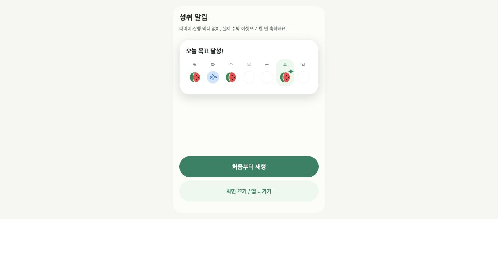

# 목표 달성과 보상 연차 인앱 알림

작성일: 2026년 10월 29일  
상태: 개발 브랜치 구현, 배포 전. Android·iPhone 실기기 검증은 별도.

## 표시 규칙

오늘의 양수 목표를 달성하면 어느 일반 화면에서든 수박 도장을 한 번 찍는다. 주간 기록은 월~일 7칸이며, 요일은 작고 차분하게 표시하고 오늘 요일만 초록색으로 강조한다. `assets/icons/watermelon-icon.png`를 그대로 사용한다.

같은 목표 달성으로 보상 연차까지 획득했으면 하나의 토스트 안에서 다음 순서로 안내한다.

1. `오늘 목표 달성!`과 도장판을 표시한다.
2. 실제 달성 요일 칸에 오늘 수박이 찍힌다.
3. 잠깐 유지한 뒤 보상 인정 도장들이 가운데로 모이며 사라진다.
4. 제목이 `보상 연차를 받았어요!`로 바뀌고 같은 자리에서 티켓 `+1`이 나타난다.
5. 보상 장면이 완성된 뒤 6초간 유지하고 사라진다. `확인하기`는 연차 화면으로 이동하며 사용·예약·지급을 요청하지 않는다.

연차를 받지 않는 날은 도장 장면만 4초간 유지한다. 타이머 숫자, 소멸 진행 막대, 별도 수량 배지, 반복 설명은 넣지 않는다. 보상 장면에는 도장판이 남지 않으며, 티켓 안에서 제목의 보상 이름을 반복하지 않는다.

토스트의 너비와 상단 위치는 유지한다. 처음부터 큰 빈 보상 영역을 잡지 않고 내용에 맞춰 높이만 늘린다. 화면 바깥의 조작이나 공부 측정을 막지 않는다.

## 오늘과 복귀

- 오늘은 기존 서버 기준 공부 날짜이며 한국시간 오전 6시에 바뀐다.
- 기본 타이머로 화면 밖에서 달성했으면 같은 공부 날짜에 복귀할 때 최신 기록을 확인한다. 앱 재실행과 웹 새로고침도 같은 규칙이다.
- 지난 공부 날짜·지난주 축하는 생략한다. 알림 보관, 다시보기, 읽음 이력용 서버 저장은 만들지 않는다.
- 사용자·방별로 해당 기기에 오늘의 안내 시작 날짜만 저장한다. 한 번 표시하기 시작했다면 중간에 잠금·앱 이탈·종료가 발생해도 복원하지 않는다.
- 기기나 브라우저 사이의 표시 여부는 동기화하지 않는다. 저장소를 지우면 같은 날 안내가 다시 나올 수 있다.
- 입장과 초기 화면 복원이 끝난 후 표시하며, 팝업·키보드가 열려 있으면 기다린다. 표시 전에 날짜가 바뀌면 이전 축하를 버린다.

## 실제 기록과 보상

양수 목표와 실제 인정 공부 시간을 확인한다. 휴무와 미설정은 자동 달성이 아니다. 연차일의 실제 목표 달성은 축하할 수 있지만 기존 연차 보상 인정 일수에서는 제외한다.

보상 카드는 오늘의 달성으로 같은 주에 보상 인정 6일을 채우고 실제 지급 내역의 획득 날짜도 오늘인 경우에만 표시한다. 토요일이 항상 보상일인 것은 아니며, 7번째 달성에는 추가 보상을 안내하지 않는다. 무료·관리자·이전 날짜 지급분은 통합 카드 조건에 포함하지 않는다.

Android 허용앱 모드의 이탈 중지는 먼저 정산한다. 가드 정산이나 서버 확인이 실패하면 오래된 타이머를 근거로 성공을 안내하지 않는다. 연차 조회에서 누락 지급을 복구하는 기존 규칙을 재사용하며 알림 열람을 지급 조건으로 만들지 않는다.

알림형을 먼저 표시한 뒤 늦게 보상 결과가 도착해도 별도 보상 카드를 추가하지 않는다. 판정에 필요한 기록·보상 조회가 실패하면 같은 날짜의 다음 갱신까지 안내를 보류한다.

## 접근성과 성능

- 큰 글자와 320px 화면에서 제목·요일·버튼을 읽을 수 있어야 한다.
- 닫기와 연차 이동 버튼은 44px 이상의 터치 영역을 갖는다.
- 동작 줄이기 설정에서는 이동·회전·모으기 연출을 생략하고 완성 상태를 제공한다.
- 스크린리더 사용 시 완성 상태의 유지 시간을 10초로 늘린다. 버튼에 포커스가 있는 동안 자동 소멸을 멈춘다.
- 푸시 권한이나 새로운 네이티브 의존성은 필요하지 않다.
- 시계는 기존 공통 시계를 구독하고 경계에서만 확인한다. 백그라운드 상시 알림 조회나 매초 서버 요청을 추가하지 않는다.

## 구현과 Storybook

`src/features/celebrations/`에 순수 판정 모델, 공통 표시 컴포넌트, 앱 연결을 둔다. 기존 StudyProvider의 확인 조회는 가드 정산을 통과한 최신 스냅샷만 축하에 제공한다. 기존 Dialog와 업데이트 안내는 전역 표시 차단 여부를 공유한다.

```bash
npm run storybook
```

`공통 컴포넌트 → 성취 토스트`에서 다음 항목을 확인한다.

- 오늘 목표 달성 도장, 보상 연차 도장 모으기와 제목 전환
- 도장판·보상 티켓 정지 화면
- 오늘 칸은 달력과 동일한 연두색(`colors.soft`), 휴무·연차 칸은 공통 수평 비행기 아이콘
- 알림 시작 380ms 뒤 도장이 내려앉는 순간 수박 오른쪽 위에 채워진 초록 네 갈래 반짝이가 빠르게 등장해 480ms 동안 한 번 반짝이고 고정됨. 동작 줄이기에서는 최종 상태로 표시
- 320px, 동작 줄이기, 스크린리더 유지 시간
- 화면 밖에서 달성 후 복귀, 지난 날짜 생략, 7일째, 연차 사용일

Storybook의 다시 재생 버튼은 검증 도구이며 앱에 알림 다시보기 기능을 추가하는 것이 아니다. 복귀 스토리는 화면 상태를 체험하는 예시다. 실제 데이터 판정·중복 방지·가드 실패는 자동 테스트로 별도 검증하며, 잠금과 허용앱 동작의 최종 확인은 실기기에서 수행한다.



