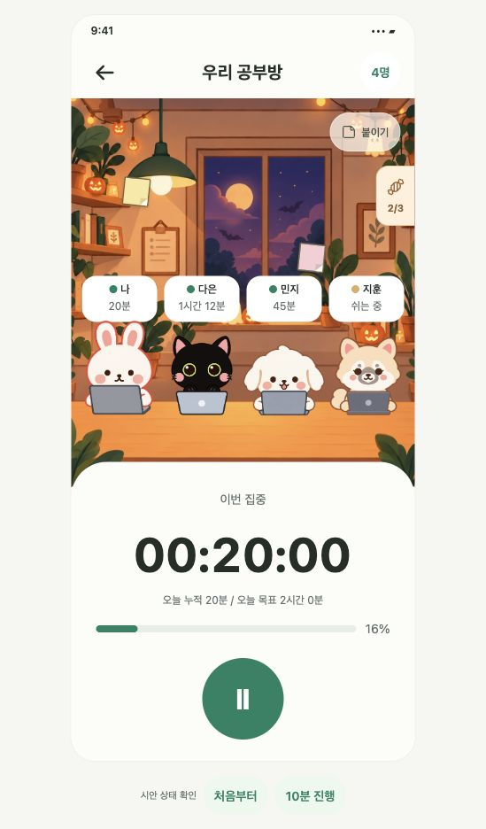

# 포스트잇 디자인 보유·지급과 서버 이미지 운영 명세

작성일: 2026년 10월 30일  
상태: 코드 구현·격리 검증 작업본 · 공유 서버 반영 및 앱 배포 전  
대상: Android 앱과 iPhone 웹앱

이벤트 보상으로 포스트잇 디자인을 자동 지급한다. 사용자는 기존 포스트잇 작성창에서 받은 디자인을 확인하고 선택한다. 디자인 PNG와 표현 정의도 서버에서 관리하여 최초 지원 앱 배포 후에는 같은 규격의 디자인을 앱 재배포 없이 등록·지급한다.

## 1. 기준 코드와 현재 상태

- 현재 체크아웃의 `src/features/postits/PostitBoard.tsx`는 기본 3색 선택·작성·배치·열람을 제공한다. `model.ts`는 그 3색만 허용한다. 이미지 디자인과 개인별 보유 기능은 아직 없다.
- 기준 PR: [#49 이벤트 예약과 서버 배경·스킨 이미지 운영 추가](https://github.com/Daeun-100/-YumYumStudy/pull/49), 확인 커밋 `f703e35` (최신 주제 경로 단순화 포함).
- 해당 PR 최신 구조는 PNG를 Supabase Storage `event-artwork` 버킷의 주제별 경로에 저장하고, DB의 독립 이미지 라이브러리에 등록한다. 운영자는 이미지 버전 UUID 없이 주제·파일 경로로 관리하며 실제 지급과 구분한다.
- 현재 이미지 manifest는 `skin`과 `background`, 홈·집중 두 파일만 지원한다. URL 경로 검증·서버 검증·운영 CLI·앱 캐시도 그 구조를 전제로 한다. 이 기능에서 포스트잇 단일 PNG 형식과 사용 권한을 추가한다.
- 해당 PR의 자동 예약 종류는 `grant_skins`, `set_backgrounds`다. 공부 조건 판정과 포스트잇 지급은 이번 별도 규칙·지급 기록으로 구현한다. PR 병합·production 지원 앱 배포 완료를 전제하지 않는다.

## 2. 사용자 흐름

1. 서버가 이벤트 참여 조건을 충족했음을 확인하고 디자인을 지급한다. 수령 버튼이나 별도 이벤트 화면은 만들지 않는다.
2. 서버에서 신규 보유가 확정되면 기존 공통 인앱 토스트로 안내한다.
   - 제목: `🎃 할로윈 포스트잇을 받았어요!`
   - 본문: `포스트잇을 쓸 때 종이 디자인에서 선택해 보세요.`
3. 공부방에서 기존 `붙이기` 버튼을 누른다.
4. 작성창의 기존 색상 선택 영역을 `종이 디자인`으로 확장한다. 기본 3색과 내가 받은 디자인을 동일한 크기의 원형 선택 버튼으로 표시한다. 추가 디자인은 PNG 일부를 확대해 원형으로 잘라낸 견본처럼 보여주며, 사각 썸네일이나 이름표를 붙이지 않는다. 접근성 이름에는 디자인 이름을 제공한다. 많아지면 가로 스크롤하며 선택 상태를 구분한다.
5. 디자인을 선택하면 작성창에 즉시 미리보기를 적용한다. 내용을 쓰고 기존 방식으로 위치를 선택해 붙인다.
6. 방에 붙은 작은 포스트잇과 눌러 연 읽기 창 모두 선택한 디자인을 표시한다.

스킨 보관함과 별도의 포스트잇 보관함·상점·전역 장착 화면은 추가하지 않는다. 미보유 이벤트 디자인은 선택 목록에 노출하지 않는다. 획득 안내를 놓쳐도 작성창에서 항상 보유 디자인을 확인할 수 있다.

## 3. 서버와 앱의 역할

| 항목 | 관리 위치·정책 |
| --- | --- |
| 실제 디자인 PNG | 기존 `event-artwork` Storage 버킷의 포스트잇 전용 경로 |
| 이름·대체 색상·본문 색상·주제·이미지 정보 | 서버 디자인 카탈로그와 주제별 이미지 라이브러리 |
| 개인별 보유와 지급 근거 | 서버. 사용자+디자인별 한 번 보유 |
| 이벤트 대상·기간·공부 조건 | 서버. 앱 시간이 아닌 서버 기준으로 판정 |
| 붙인 종이의 디자인 | 포스트잇에 디자인 ID와 표현 리비전 참조 저장 |
| 디자인 표시·선택·이미지 캐시 | 앱. #49의 다운로드 공유·동시 실행 제한·실패 대체 원칙 재사용 |
| 기본 3색 | 기존 로컬 기본값 유지. 보유 지급 불필요 |

PNG는 공개 가능한 꾸미기 파일이다. 이미지 주소를 안다는 사실은 디자인 사용 권한이 아니다. 보유 검증은 포스트잇 생성 시 서버에서 수행한다. 사용자 업로드와 임의 외부 URL 입력은 제공하지 않는다.

## 4. 이미지 형식과 운영

아래 규격으로 구현하며 Storybook에서 가독성과 배치를 확인한다.

- 디자인당 PNG 한 장, 1024×1024, 최대 2 MiB. 8비트 RGB/RGBA, 비인터레이스 PNG를 사용한다.
- 경로: `<theme>/postits/<design-id>/paper.png` 또는 같은 주제 폴더의 명시한 PNG 경로. 운영자가 이미지 UUID를 만들지 않는다. 파일 교체에는 새 파일 경로를 등록해 기존 종이의 이미지를 보존한다.
- 이미지에는 종이·테두리·장식을 포함하고 작성자 이름·사용자 메시지·삭제 및 닫기 버튼은 포함하지 않는다.
- 중앙은 메시지 가독성을 위해 비우고 장식은 가장자리에 배치한다. 이미지 전체를 같은 비율로 표시하며 늘이거나 잘라 장식 위치를 바꾸지 않는다.
- 종이 표시 영역과 앱의 버튼 영역을 분리한다. 기존 작성·읽기 창은 고정된 정사각 종이 영역 안에 메시지를 표시하도록 조정하며, 50자·줄바꿈·큰 글자에서 넘치지 않게 내부 스크롤 등으로 처리한다. PNG 위에서 읽을 본문 색상은 서버 정의의 검증된 색상 값을 사용한다.
- 작은 포스트잇에서는 같은 PNG를 축소 표시한다. 기본 종이에 쓰던 접힌 모서리·테두리를 커스텀 PNG 위에 중복해서 그리지 않는다.
- PNG 서명·크기·CRC·압축 데이터 검사는 #49의 검사기를 확장해 재사용한다. 업로드 후 공개 다운로드 바이트 크기·SHA-256을 대조한다.
- 운영 순서: 파일 검사 → 주제 폴더 업로드 → 다운로드 검증 → 라이브러리 등록 → 지급 활성화 → 실제 지급. 등록과 동시에 활성화할 수도 있지만 등록만으로 사용자에게 지급하지 않는다.
- 게시만으로 지급하지 않는다. 지급을 중지해도 기존 보유와 사용은 유지한다. 이미 지급한 디자인의 파일·리비전은 보존한다.

기존 홈·집중 전용 manifest에 가짜 두 파일을 넣지 않는다. `postit`용 주제별 단일 파일 표현 형식을 명시적으로 추가하고 스키마·경로 허용 목록·검사기·캐시 키를 함께 확장한다. 다른 표현 동작이나 지원하지 않는 스키마는 앱 업데이트가 필요하다.

## 5. 데이터와 권한

실제 테이블·함수명은 구현 단계에서 #49와 맞춘다. 다음은 필요한 논리 기록이다.

| 기록 | 필수 정보 |
| --- | --- |
| 디자인 카탈로그 | 디자인 ID, 이름, 현재 이미지 라이브러리 정의, 신규 지급 활성 상태 |
| 표현 스냅샷 | 서버 내부 식별자, 디자인 ID, 주제, PNG 경로·크기·해시·규격, 대체 색상, 본문 색상. 이미 붙인 종이 보존용이며 운영자 입력 버전이 아님 |
| 사용자 보유 | 사용자 ID, 디자인 ID, 최초 지급 시각, 이벤트·지급 근거 키 |
| 포스트잇 | 기존 정보 + 선택한 디자인 ID·표현 리비전. 기본 종이는 기존 color 사용 |
| 이벤트 지급 규칙·결과 | 이벤트 ID, 대상 방, 공부 기간, 필요 초, 보상 디자인, 사용자별 처리 결과 |

- 기존 사용자·포스트잇을 삭제하거나 기존 색상을 일괄 변환하지 않는다. 디자인 참조가 없는 종이는 기존 방식으로 표시한다.
- 새 포스트잇 생성은 기존 입장·방 권한 검증과 함께 작성자의 디자인 보유를 확인하고, 서버가 현재 등록된 표현 스냅샷을 선택해 저장한다. 앱이 보낸 임의 스냅샷·URL은 신뢰하지 않는다.
- 다른 사람은 보유하지 않아도 같은 방에 붙어 있는 포스트잇의 해당 리비전을 읽어 표시할 수 있다. 열람 권한이 개인 사용 권한을 만들지 않는다.
- 개인 보유 목록은 본인만 조회하고 일반 앱의 보유 추가·수정·삭제는 차단한다. 디자인 게시·지급은 신뢰된 운영 경로만 허용한다.
- 게시 리비전이 변경되어도 이미 붙인 종이는 저장된 리비전을 유지한다. 새로 붙일 때는 새 게시 리비전을 사용한다.
- 포스트잇의 현재 공부 날짜 표시·공유·삭제 권한은 기존 정책을 유지한다. 종이가 다음 공부 날짜에 사라져도 디자인 보유는 남는다.

## 6. 자동 지급과 할로윈 적용안

확정한 방향은 조건 충족 시 자동 지급이다. 대화에서 제안한 `할로윈에 누적 30분 공부`를 사용자가 선택했다. 실제 행사 등록 전 대상 방·시작/종료 시각·디자인 ID를 확정한다. 아직 행사 예약이나 지급은 하지 않는다.

- 초기 지원 조건은 지정 공부 날짜의 누적 인정 공부 시간 이상으로 제한한다. 확정한 공부 조건은 1,800초(30분)이며 서버 공부 날짜인 한국시간 오전 6시 기준을 사용한다.
- 진행 중 세션은 기존 서버 공부 정산 규칙으로 기간 안의 시간만 포함한다. 휴무·목표 미설정·연차 사용 여부와 무관하게 실제 공부 시간을 인정하는 방안을 기본으로 한다.
- 공부 시간이나 달성 여부를 앱에서 임의 전송해 확정하지 않는다. 지급 함수는 서버 기록과 이벤트 설정으로 재검증한다.
- 앱은 기존 공부 현황 갱신·공부 종료·앱 복귀·작성창 진입에서 필요한 보상 확인을 요청한다. 이벤트 중에는 앱이 계산한 조건 도달 시점에 한 번 확인을 요청할 수 있지만, 서버가 최종 판정한다. 매초 네트워크 요청이나 별도 상시 폴링은 추가하지 않는다.
- 앱 종료·오프라인으로 즉시 확인하지 못하면 다음 연결 시 확정된 기간 내 기록으로 누락 지급을 복구한다. 기간 종료 후 공부 시간은 합산하지 않는다. 사용자에게 보이는 지급 시점은 다음 서버 확인까지 늦어질 수 있다.
- 사용자+디자인의 유일 보유 제약과 사용자+이벤트+보상의 지급 키로 동시 요청·재시도·여러 기기에서 중복 지급을 막는다. 이미 보유한 경우 최초 지급 시각과 근거를 덮어쓰지 않는다.
- 이벤트가 끝나면 신규 참여 시간 집계만 종료하며, 기존 조건 충족자의 누락 지급 복구와 이미 받은 디자인의 영구 사용은 유지한다.
- #49의 시간 지정 스킨 예약에 공부 조건을 억지로 끼우지 않는다. 조건 판정·디자인 지급을 별도 지원 종류로 구현하고 실행 기록 체계는 재사용한다. 임의 조건식을 실행하는 범용 이벤트 엔진은 만들지 않는다.

## 7. 획득 안내와 갱신

- 지급 DB 반영이 성공한 뒤에만 획득 안내를 등록한다. 이미지 다운로드 실패는 지급을 취소하지 않는다.
- 기존 공통 토스트를 사용하고 작성창·키보드·다른 모달과 겹치는 동안은 기존 대기 정책을 따른다.
- 사용자+보유 지급 ID로 기기별 안내 완료를 영속 저장한다. 대기열 등록 시점이 아니라 실제 표시 시점에 완료 처리한다. 여러 기기 간 정확히 한 번 표시는 요구하지 않는다.
- 신규 보유가 확정되면 선택 목록을 갱신한다. 별도 관리자 화면·푸시 알림 연동은 이번 필수 범위에 넣지 않는다.
- 보유 목록·메타데이터 캐시는 사용자와 방을 구분한다. 앱 복귀·재연결·작성창 진입 시 재확인하고 이전 사용자의 늦은 응답을 적용하지 않는다.

## 8. 실패와 구형 앱

- 이미지 로딩 중·실패·오프라인 캐시 없음에는 정의의 대체 색상 또는 기본 노랑으로 표시한다. 메시지 읽기·공부 시작/중지·저장을 막지 않는다.
- 이미 준비된 정상 리비전은 새 이미지 준비가 끝날 때까지 유지한다. 다운로드 공유와 제한은 #49의 공통 자원을 확장해서 사용한다.
- 클라이언트가 모르는 디자인·스키마는 기본 종이로 표시하되 서버의 보유·포스트잇 참조는 지우지 않는다.
- 구형 디코더는 기본 3색만 허용한다. 따라서 커스텀 종이도 기존 `color` 필드에는 3색 중 호환 대체 색상을 내려주고 새 디자인 필드는 추가 필드로 전달한다. 구형 응답·구형 앱에서 실제로 읽히는지 계약 검증을 수행한다.
- 최초 지원 앱과 서버 확장을 먼저 배포하고 신규 디자인을 활성화한다. 이후 동일 규격의 PNG·표현 등록·지급은 앱 재배포 없이 운영한다. 초기 기능 배포 없이 서버 업로드만으로 현재 앱에서 사용할 수 있다고 안내하지 않는다.

## 9. 구현 범위와 검증

이번 범위는 서버 PNG·카탈로그·리비전 운영, 사용자 보유, 공부 조건 자동 지급, 기존 작성창 디자인 선택, 작은 종이·작성·읽기 표시와 획득 토스트다. 별도 보관함·수령 버튼·상점·양도·사용자 이미지 업로드·새 스킨·연차·현금 보상은 추가하지 않는다.

구현 후 다음을 확인한다.

- 29분 59초/30분 경계, 세션 분할 합산, 오전 6시 경계, 기간 종료 뒤 공부 제외, 다음 접속 누락 복구.
- 중복 요청·동시 기기·기보유 재지급에서 보유 1건과 최초 지급 근거 보존.
- 미보유 디자인 작성 거부, 같은 방 친구의 커스텀 종이 열람 허용, 다른 방·다른 사용자 보유 접근 거부.
- 기존 3색·기존 포스트잇·50자·배치·공유·삭제·날짜 전환 동작 유지.
- 원격 전용 ID를 앱 재배포 없이 게시·지급·표시하고, 리비전 교체 후 기존 종이는 이전 리비전 유지.
- 파일 규격 오류·해시 불일치·이미지 실패·캐시 없음·알 수 없는 스키마에서 메시지와 기본 종이 유지.
- 작성 중 보상 수신·토스트 대기·재실행 안내 중복·사용자/방 변경의 늦은 응답 처리.
- 320px/390px Storybook 웹에서 선택 목록·선택 상태·정사각 종이·50자 줄바꿈·큰 글자·PNG 장식/본문 대비 확인. Android와 iPhone 웹앱 실제 표시는 별도로 검증.
- 린트·타입 검사, 필요한 보유/권한/지급/호환성 검사와 Storybook 검증 완료 후 기존 develop PR·master 릴리스 절차를 따른다.

이번 작업은 코드 구현과 격리 DB·Storybook 검증이다. 공유 DB 변경·실제 디자인 PNG 업로드·사용자 지급·이벤트 등록·앱 배포는 수행하지 않는다. 운영 방법은 [포스트잇 디자인 운영](../operations/POSTIT-DESIGNS.md)을 따른다.

## 10. 최신 주제별 라이브러리와의 연결

포스트잇 운영은 #49와 같은 `schemaVersion: 2`, `theme`, PNG 파일 경로로 등록한다. `admin_register_artwork`와 공통 `artwork_library`를 확장하며, 스킨·방 배경 등록은 기존 구현으로 전달한다. 사용자별 보유는 디자인 ID로 유지한다.

이미 붙인 종이는 당시 표현을 유지해야 하므로 서버가 포스트잇 전용 보존 테이블에 불변 스냅샷과 내부 UUID를 자동 생성한다. 제거된 구버전 이미지 게시 API는 사용하지 않는다. 이 UUID는 앱 동기화·포스트잇 참조에만 사용하며 운영자가 생성·선택·게시하는 이미지 버전이 아니다. 라이브러리에는 UUID 없는 원래 정의를 보관하고, 같은 정의 재등록은 같은 내부 스냅샷을 재사용한다. 자세한 입력 형식은 운영 문서를 따른다.

## 11. 집중 화면 참여 북마크 · Storybook 시안

사용자 요청으로 누적 공부 30분과 집중 화면 진입을 기준으로 한다. 참여 UI는 홈 카드 대신 **집중 공부방 오른쪽 가장자리의 작은 북마크**로 정리했다.

- 북마크에는 사탕 아이콘과 `0/3`, `1/3`, `2/3`, `3/3`만 표시한다. 지급 확인 완료 후에는 선물 아이콘과 `완료`를 표시한다. 최소 터치 폭은 44px이다.
- 공부방 그림 위에 겹쳐 표시하므로 타이머·캐릭터 영역의 높이를 줄이지 않는다. 기존 포스트잇 작성 버튼은 상단 16px, 이벤트 북마크는 상단 76px에 둔다. 버튼의 44px 터치 높이와 북마크 사이에 16px 간격을 확보한다. Storybook에도 실제 PostitBoard의 붙이기 버튼·샘플 종이·작성/열람을 함께 표시해 배치를 확인한다.
- 누르면 이벤트 안내 모달이 열린다. 사탕 3칸, 10분·20분·30분 단계와 받을 종이 미리보기, 30분 지급·영구 사용 안내를 보여준다. 닫으면 집중 화면으로 돌아온다.
- 사탕 수는 해당 이벤트의 서버 인정 공부 초에서 계산한다. 별도 재화·소비·교환은 추가하지 않는다.
- Storybook `화면/집중 할로윈 이벤트`에서 공부 전·10분·20분·30분 완료·지급 확인 중·320px 상태를 비교한다. 화면 아래 상태 변경 버튼은 미리보기 전용이다.
- 현재는 Storybook 시안만 구현했다. 실제 집중 화면 노출과 서버 진행 정보 연결은 아직 하지 않았다. 종이 PNG도 기존 도형 검증 파일을 사용한다. React Native View/Pressable 레이아웃과 아이콘 공통 속성을 사용하지만 실제 기기 시각 검증은 별도다.

